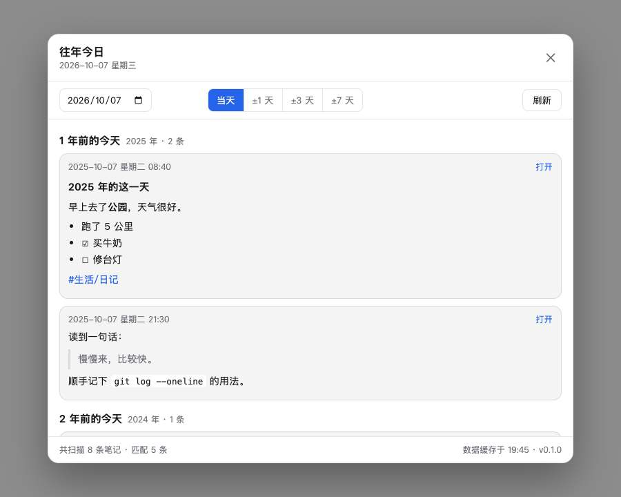
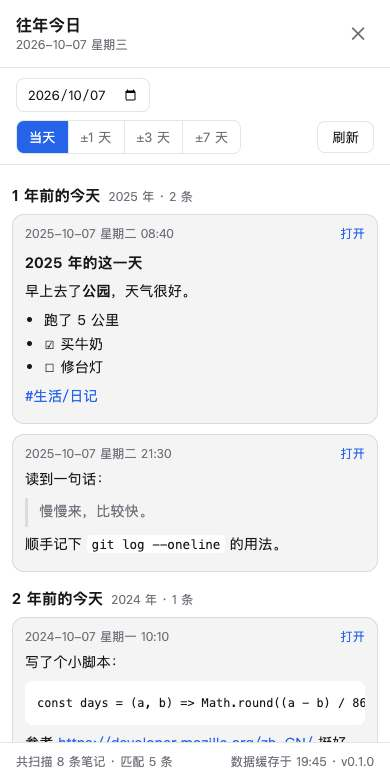

# Memos 往年今日

给 Memos 网页版加一个「往年今日」按钮：点开就能看到往年同一天你写过的笔记，按年份倒序排好，可以放宽到前后若干天。

[中文](#memos-往年今日) · [English](#english)



## 安装

1. 打开你的 Memos，用管理员账号登录
2. 头像 → **设置 → 系统**，找到 **自定义脚本**（Additional script）
3. 把 [`memos-on-this-day.js`](memos-on-this-day.js) 的全部内容粘进去
4. 保存，刷新页面

右下角会出现「往年今日」按钮。这是实例级设置，改一次所有设备都生效。

> 建议用 [Releases](https://github.com/zhengshenrui/memos-on-this-day/releases) 里的固定版本，而不是直接复制 main 分支——以后代码更新了也不会影响你正在用的版本。

## 用法

- **悬浮按钮**：右下角，按住可以拖动，位置记在本地，下次打开还在你放的地方
- **日期**：默认今天，可以改成任意一天
- **范围**：当天 / ±1 天 / ±3 天 / ±7 天，跨天的条目会标出 `+1 天`、`-2 天`
- **刷新**：强制重新拉取；平时打开走内存缓存，5 分钟内不重复请求
- **关闭**：右上角 ✕、点空白处、按 Esc 都可以

正文按 Markdown 渲染：标题、列表、待办、引用、代码块、链接、图片、标签高亮都支持。

## 手机上

手机浏览器打开你的 Memos 就能用，功能和电脑上一样。想要 App 一样的入口，可以在浏览器里「添加到主屏幕」。Moe Memos 这类原生客户端不加载网页，所以看不到这个按钮。

## 界面

桌面版见顶部截图，手机版长这样：



深色/浅色跟随 Memos 主题自动切换。

## 安全与隐私

装别人的自定义脚本，等于让对方的代码在你的浏览器里运行，而且带着你的登录态。所以这里把话说明白：

| 项目 | 说明 |
| --- | --- |
| **网络请求** | 只有同源的两个接口：`/api/v1/memos`（读笔记）、`/api/v1/auth/refresh`（续登录态） |
| **凭据** | 复用你当前的浏览器登录态，不要求新建 Token，不读取 Cookie |
| **第三方** | 不向任何外部服务器发送数据，代码里没有硬编码的外部地址 |
| **本地写入** | 只写 2 个 key：按钮位置、范围选择 |
| **缓存** | 笔记只在内存里放 5 分钟，关掉页面就没了 |
| **代码** | 单文件、未压缩、零依赖，可以直接读 |

这些不是口头承诺，测试里就守着这几条（见 [`test/logic.test.js`](test/logic.test.js)）。真不放心的话，装之前自己扫一遍代码，或者用 Release 里的固定版本。

## 兼容性

| Memos 版本 | 状态 |
| --- | --- |
| 0.29.x | 已测试 |
| 0.30+ / 更早版本 | 未验证。Memos 的接口在不同大版本间有变化，可能失效 |

脚本在加载时会自适应一部分接口差异，但没法覆盖所有情况。如果升级 Memos 后按钮没反应，欢迎提 issue 并附上浏览器控制台的报错。

## 常见问题

**按钮没出现？** 确认脚本已保存、页面已刷新；打开浏览器控制台看看有没有报错。

**提示「登录状态已失效」？** 刷新页面重新登录即可。

**结果为空？** 先试 ±7 天。再确认那条笔记的**创建时间**是那天——Memos 只有创建时间，没有「事件发生时间」，所以补记的旧事会算在补记的那天。

**结果比预期少？** 评论类笔记会被自动过滤；归档（Archived）的笔记不在默认列表里。

## 卸载

设置 → 系统 → 自定义脚本，清空输入框，保存，刷新。服务端不留任何痕迹。

## 开发

只有一个源文件，不需要构建。测试需要 Node 18+：

```bash
node --test
```

在浏览器控制台里可以这样自查：

```js
__memosOnThisDay.version
__memosOnThisDay.open()
```

## 许可

[MIT](LICENSE)。非官方项目，与 [usememos/memos](https://github.com/usememos/memos) 没有隶属关系。

---

# English

Adds an "On This Day" button to the Memos web app: see what you wrote on this date in previous years, newest year first.

## Install

1. Open your Memos instance and sign in as an admin
2. Avatar → **Settings → System** → find **Additional script**
3. Paste the entire contents of [`memos-on-this-day.js`](memos-on-this-day.js)
4. Save, then reload the page

The button appears in the bottom-right corner. This is an instance-level setting, so it applies to every device and browser.

> Prefer the pinned version in [Releases](https://github.com/zhengshenrui/memos-on-this-day/releases) over copying from `main`.

## Usage

- **Floating button** — bottom-right, draggable, remembers where you put it
- **Date** — defaults to today, any date works
- **Range** — same day, ±1, ±3 or ±7 days; off-day matches are labelled `+1 day` / `-2 days`
- **Refresh** — forces a re-fetch; otherwise results are cached in memory for 5 minutes
- **Close** — the ✕, clicking the backdrop, or pressing Esc

Memo content is rendered as Markdown: headings, lists, task lists, quotes, code blocks, links, images and highlighted tags.

## Security and privacy

Pasting someone else's custom script means running their code in your browser, with your session. So, plainly:

| Item | Detail |
| --- | --- |
| **Network** | Two same-origin endpoints only: `/api/v1/memos` and `/api/v1/auth/refresh` |
| **Credentials** | Reuses your existing browser session. No token to create, no cookie access |
| **Third parties** | Nothing is sent anywhere else; no external hostnames in the code |
| **Local storage** | Two keys: button position and range preference |
| **Cache** | Memos are cached in memory for 5 minutes and vanish when the tab closes |
| **Code** | One uncompressed, dependency-free file you can read top to bottom |

These are enforced by tests, not just claimed — see [`test/logic.test.js`](test/logic.test.js).

## Compatibility

Tested against Memos 0.29.x. Other versions are untested — Memos changes its API between major releases, so newer or older versions may break. If the button stops working after an upgrade, please open an issue with the browser console error.

## Uninstall

Settings → System → Additional script, clear the field, save, reload. Nothing is left behind on the server.

## Development

Single source file, no build step. Tests need Node 18+:

```bash
node --test
```

## License

[MIT](LICENSE). Unofficial project, not affiliated with [usememos/memos](https://github.com/usememos/memos).
